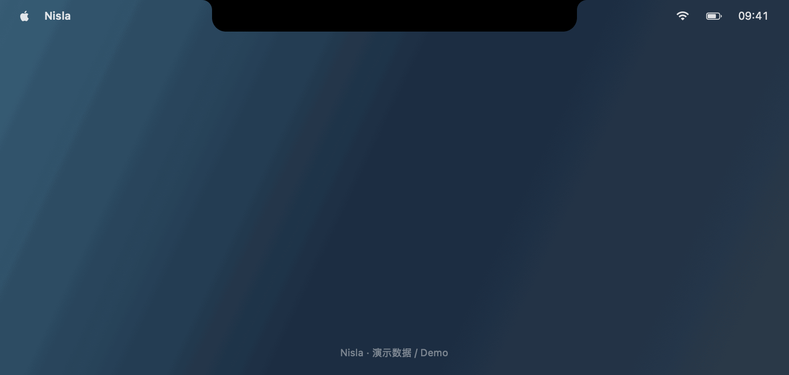
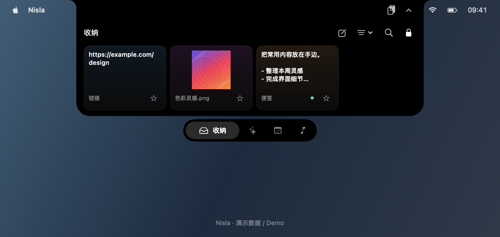
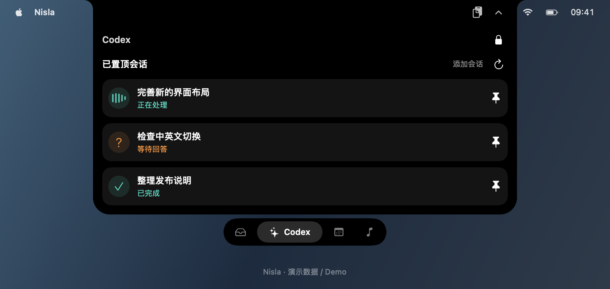
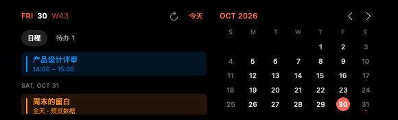
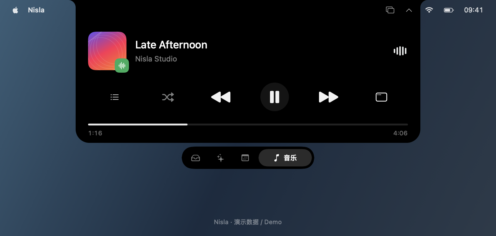
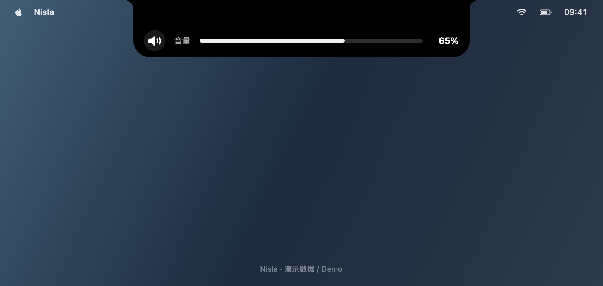
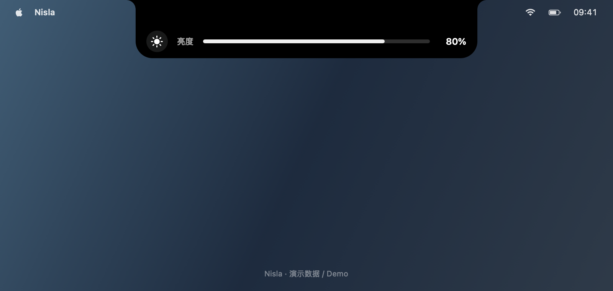
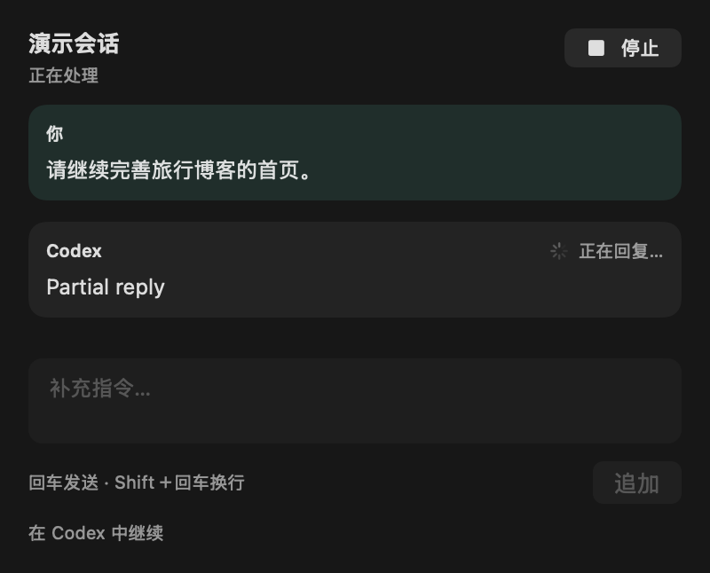

<p align="center">
  
</p>

<h1 align="center">Nisla</h1>

<p align="center">把文件、音乐和日程，放在 Mac 的屏幕边缘。</p>
<p align="center">macOS 14+ · Apple Silicon & Intel · Swift / SwiftUI · MIT</p>

<p align="center">
  <a href="https://github.com/matt-liao-0108/Nisla/releases">下载安装包</a> ·
  <a href="#在刘海中使用-codex">Codex 使用说明</a> ·
  <a href="#cursor">Cursor 使用说明</a> ·
  <a href="#快速开始">从源码构建</a> ·
  <a href="https://github.com/matt-liao-0108/Nisla/issues">反馈问题</a>
</p>

Nisla 是一个原生 macOS 屏幕边缘收纳与实时活动工具。把文字、图片或文件拖到屏幕边缘，快速收纳；也可以在同一个面板里查看音乐、日历和 Codex / Cursor Agent 活动。

项目仍处于测试阶段，欢迎反馈使用体验和兼容性问题。

## 0.2.56 更新

- **Codex 模型选择**：回复框旁可选择当前服务返回的模型，默认沿用会话模型；下一次发送时生效，运行中停止或完成后可切换。
- **Cursor 接入**：在设置 → Agent 切换到 Cursor，配置支持 ACP 的 Cursor CLI 和项目文件夹；支持创建／恢复 Nisla 会话、流式回复、停止、权限确认、问题回答与计划审批。
- **关于 Nisla**：菜单栏与设置 → 外观新增版本信息，展示当前运行副本的版本号、构建号与路径，方便区分不同位置的同名副本。
- Agent 页可切换 Codex／Cursor，紧凑活动使用对应图标；切换来源时关闭旧预览，保留各自会话与运行状态。

版本 `0.2.56`，构建号 `58`。Cursor 需要另外安装 CLI 并运行 `agent login`；不能接管 Cursor 编辑器中的现有聊天。已通过编译、隔离协议和相关界面检查，本机未安装 Cursor CLI，真实登录及模型任务尚未验证。详见 [发布说明](docs/releases/v0.2.56.md)。

**English:** Version 0.2.56 (build 58) adds Codex model selection, Cursor CLI integration over ACP, and an About Nisla entry with the running app’s version, build, and location. Install an ACP-capable Cursor CLI and run `agent login` before connecting. Existing Cursor editor chats cannot be taken over. Live Cursor authentication and model tasks remain unverified on this machine.

<details>
<summary>历史版本更新</summary>

## 0.2.52 更新

- 贴顶刘海在展开和收起时保持一致的圆角，玻璃材质边缘同步对齐。系统不提供物理刘海的精确圆角数据，因此无法保证与硬件轮廓完全一致。
- 图片预览关闭后立即开始收起主面板，减少等待，同时避免预览关闭期间窗口尺寸不同步造成偏移。贴顶和悬浮模式均适用。
- 当前自动模式在无法确认原生岛支持时仍使用贴顶；无物理刘海时自动隐藏尚未实现。悬浮胶囊是 Nisla 自己的界面，可在设置中手动选择。

## 0.2.50 更新

图片预览关闭与主面板收起分为两个连续阶段：预览动画结束后才开始收起，避免系统显示窗口与应用窗口尺寸不同步造成动画偏移。贴顶和悬浮模式、外部点击与 Esc 均适用。已验证真实 SwiftUI 预览、模拟外部点击、连续点击与系统窗口尺寸；实际鼠标操作仍需安装后确认。

## 0.2.49 更新

默认选择 **自动（检测系统与设备）**。旧系统或无法确认支持原生岛的设备使用贴顶刘海；能力未知时回退贴顶，不仅凭 macOS 版本号或屏幕存在刘海就启用悬浮。当前尚无经过确认的原生岛设备标识，自动模式会保守使用贴顶。旧版保存的悬浮选择会一次性迁移为自动，此后手动选择会保留。

在“设置 → 外观 → 展示方式”可手动选择 **悬浮胶囊** 或 **贴顶刘海**。手动悬浮使用 Nisla 自己的界面，与菜单栏及摄像头安全区域留出间距，展开内容和底部导航合并为一个圆角容器；按 Esc 收起，点击外部关闭预览，未锁定时同时收起面板。

悬浮模式合并收纳标题和工具栏并收紧间距。图片预览关闭后会复核窗口位置；收起时取消尚未完成的悬停预览，避免延迟任务在面板关闭后打开。真实 SwiftUI 图片预览及模拟悬停延迟已测试，实际鼠标悬停场景仍需安装后验证。

这是 Nisla 自己的悬浮界面，不代表已接入 Apple 原生 Dynamic Island，也不代表完成了新款 Mac 的实机验证。若系统提供的音乐控制已满足需求，可关闭 Nisla 音乐功能并隐藏音乐页；音量/亮度接管也可保持关闭，继续使用系统控制。

## 0.2.48 更新

- 默认使用悬浮胶囊，展开后内容和底部 Tab 位于同一个圆角容器；保留贴顶刘海选项及原有深色渐变。浮动音量、亮度提示使用横向胶囊，不再预留物理刘海的空白。
- 修正 Esc 收起时面板偏移和连续按 Esc 的位置问题。文本预览中的编辑器可能先处理一次 Esc，随后再按 Esc 收起面板；点击面板及预览以外的区域会关闭预览，未锁定时同时收起面板。
- Codex 对话只读加载本地用户与助手历史，运行中、未连接或会话被其他进程占用时仍可查看；支持加载更早消息，向上滚动暂停跟随，点击“回到最新消息”恢复。

此版本为 Preview，构建号 `50`。Apple Silicon / Intel 双架构 Release 编译和 ad-hoc 签名验证通过。悬浮胶囊几何与预览、Esc 偏移和连续 Esc、文本预览焦点、外部点击行为及 Codex 本地历史专项检查通过；仍需实机验证的范围见下方“当前限制”。详见 [0.2.48 发布说明](docs/releases/v0.2.48.md)。

## 0.2.47 更新

- Codex 日志预览与实时助手回复支持 Markdown，正确展示链接、段落、列表、粗体、标题、代码块与表格；本地文件链接点击后在 Finder 定位。
- 代码块可复制；保留原有回复、追加、停止操作。文件变更、Undo 等 Codex 专属卡片尚不支持同步。
- 修正音乐单行提示被误算成两行的问题，收紧无歌曲时的按钮行和底部留白，并验证中英文长短提示在多种宽度下的布局。

此版本为 Preview，构建号 `49`。Markdown、布局和数据专项检查通过，其他已知限制仍见下方说明。

## 0.2.46 更新

- Codex 对话增加“停止”：收到结束确认后显示“已中断”，保留部分回复；失败或确认超时可重试。
- 对话面板缩小输入框、压缩空白并移除重复提示，区分发送、等待回复、流式回复及中断状态；任务运行时可“追加”指令。
- 补充下方 Codex 连接、回复、会话占用排查和退出旧版应用的操作说明。
- 延续 0.2.45 恢复的深色渐变及独立底部导航，保留顶部设置 Tab、会话筛选、结形图标和连接恢复功能。

此版本为 Preview，构建号 `48`。停止逻辑与界面已通过协议模拟及原生布局检查，真实模型任务的中断仍需实机验证；其他限制见下方“当前限制”。


</details>

## 功能

- **随手收纳**：保存文字、图片、链接、文件和文件夹，支持便签、标签、搜索、收藏和预览。
- **AirDrop 投放**：拖入文件或图片后，在独立区域松开，交由 macOS 选择接收设备。
- **音乐控制**：展示封面和播放信息，支持 Apple Music、Spotify，以及系统“正在播放”中的网易云音乐和 QQ 音乐。
- **日历与待办**：查看系统日历、订阅日历和提醒事项，快速切换日期。
- **Codex 活动**：置顶本机会话、查看运行状态和本地聊天历史；可选连接本地 App Server 以回复、追加或停止当前连接的任务。
- **Cursor Agent**：通过官方 ACP 连接 Cursor CLI，在 Nisla 中创建和恢复会话、查看流式回复、停止任务并处理权限、问题与计划确认；不能接管编辑器中的现有聊天。
- **外观与布局**：默认自动检测，无法确认支持时使用贴顶，可手动选择悬浮胶囊；支持经典黑色和系统玻璃材质，在设置中调整宽度、功能页、停靠位置和快捷键。
- **中英文切换**：默认跟随系统，也可在“设置 → 外观 → 语言”中选择简体中文或 English，切换立即生效。
- **可选系统提示**：耳机连接提示、音量和亮度媒体键接管均由用户按需开启。

### 查看版本与同名副本

从菜单栏图标选择 **关于 Nisla**，或打开 **设置 → 外观 → 关于 Nisla**。版本号与构建号读取当前运行应用的包信息；关于窗口还显示应用路径。搜索出现多个 Nisla 时，可能是「应用程序」、解压目录或开发构建里的不同副本，建议日常从 `/Applications/Nisla.app` 启动。更新时先退出旧版，再替换「应用程序」中的应用；项目构建及解压目录的副本不会自动替换。

## 界面预览

下方 GIF 依次演示收纳、Codex、日历、音乐、音量和亮度的展开与收起。现有图片展示贴顶刘海模式；自动模式在旧系统或能力未知时使用该模式。



| 收纳 | Codex 活动 |
| --- | --- |
|  |  |

| 日历 | 音乐 |
| --- | --- |
|  |  |

| 音量 | 亮度 |
| --- | --- |
|  |  |

对话区展示已发送内容与流式回复，运行中可停止或追加指令：



以上是由实际原生视图和隔离演示数据生成的经典黑色外观预览，桌面背景为示意；GIF 使用应用的展开与收起曲线合成，并非实机录屏。音量、亮度数值为模拟数据。系统玻璃的透色与折射取决于 macOS 版本和真实背景，预览不代表玻璃效果。

## 下载与安装

1. 打开 [Releases](https://github.com/matt-liao-0108/Nisla/releases)，下载已发布版本附件中的 `Nisla-版本号-universal-*.zip`。
2. 解压，把 `Nisla.app` 拖入“应用程序”。更新时先从菜单栏退出旧版，再替换应用。
3. 打开后，通过菜单栏图标进入设置，或把内容拖到屏幕边缘使用。

**怎么退出旧版？** 点击屏幕右上角菜单栏的 Nisla 图标 → **退出 Nisla**。找不到图标时，打开 macOS“活动监视器”，搜索 `Nisla` 或旧名称 `Island`，选中对应应用并点停止按钮 →“退出”。确认退出后再替换应用，并从“应用程序”打开新版；不要同时运行两份。这里的“退出旧版”只是更新安装步骤，不代表回复 Codex 必须更换版本。

需要 **macOS 14 或更新版本**，通用安装包包含 Apple Silicon 和 Intel 架构。原生玻璃材质需要 **macOS 26+**；较旧系统或开启“减少透明度”时使用黑色外观。

当前测试包使用本地 ad-hoc 签名，尚无 Developer ID 签名和苹果公证。macOS 可能阻止网络下载包首次启动；请先确认下载来源可信，再按系统提供的安全提示处理。

GitHub 自动生成的 `Source code (zip)` 是源码，不是可直接运行的安装包。

## 基本操作

| 操作 | 使用方式 |
| --- | --- |
| 收纳内容 | 拖入面板，或按 `⌃⌘P` 添加剪贴板内容 |
| 显示 / 隐藏 | `⌃⌘I` |
| 展开 / 收起面板 | 点击或悬停展开；按 Esc 收起。点击外部关闭预览，未锁定时同时收起面板 |
| 新建便签 | `⌃⌘N`，或点击收纳工具栏的编辑图标 |
| 捕获选中内容 | 默认 `⇧⌘X`，需辅助功能授权 |
| 搜索与整理 | 收纳工具栏的搜索、筛选和排序菜单 |
| 查看原文件 | 文件卡片右键 → 在 Finder 中显示 |
| 调整宽度 | 设置 → 外观；当前版本不提供手动拖拽调宽 |
| 切换展示方式 | 设置 → 外观 → 展示方式，选择“自动（检测系统与设备）”“悬浮胶囊”或“贴顶刘海” |
| AirDrop | 拖拽文件或图片，等待展开后放入右侧 AirDrop 区域 |

文本预览中的编辑器可能先处理一次 Esc，随后再按 Esc 可收起面板。快捷键均可在设置中修改。AirDrop 由 macOS 处理，不会自动选择接收人；网络图片能否直接拖入，取决于浏览器是否提供可读取的图片或文件数据。

## 在刘海中使用 Codex

### 先准备什么

- 在本机安装、配置并登录可用的 Codex，所选 **CLI 可执行文件**需要支持 `app-server`。Nisla 不附带 Codex，也不代替它完成登录。
- 至少有一个本机已保存的主会话；可先在 Codex 中创建并使用一次。当前 Nisla 用于查看和继续已有会话，不提供新建会话入口。
- 仅查看本地会话与活动无需连接服务。**顶部波形或“正在处理”可能来自日志，不代表已连接、可以回复。** 回复要以“设置 → Agent”中的连接状态和会话是否可写为准。

### 选择连接方式

| 模式 | 适用场景 | 前提与限制 |
| --- | --- | --- |
| 独立 CLI 服务（继续已保存会话） | 没有现成共享服务，希望从 Nisla 继续一个可写的已保存会话 | Nisla 启动独立的 CLI App Server，无需填写 Socket；不能接管桌面 Codex 或其他进程正在占用的会话、任务和审批 |
| 现有本地服务（共享活动） | 已有兼容的 Codex 共享服务，希望连接同一服务 | CLI 要支持共享代理，实际控制 Socket 必须正在监听；仅打开 Codex 应用窗口不保证满足条件 |

**首次只想体验回复，可先选择“独立 CLI 服务”。** 默认模式仍为“现有本地服务”，Nisla 不会在连接失败后自动切换。

### 首次连接与回复

1. 点击菜单栏 Nisla 图标 → **设置 → Agent**。
2. 检查“Codex 可执行文件路径”：填写可执行的 `codex` 文件的绝对路径，不能只填 `Codex.app`、`ChatGPT.app` 或项目文件夹。应用会尝试查找已安装的常见位置；另一台电脑可能需要重新选择。
3. 如通过终端安装，可运行下面的只读命令检查位置与兼容性；把第一条输出的完整路径填入设置。若提示找不到命令，先确认本机安装方式，不要照抄他人的路径。

   ```bash
   command -v codex
   codex --version
   codex app-server --help
   ```

4. 选择 **独立 CLI 服务（继续已保存会话）**，点击 **连接 / 重连**。此模式无需手动在终端再启动一份服务，控制 Socket 输入框会禁用。状态显示“已连接独立 Codex 服务（非桌面共享连接）”后再进行下一步；连接本身不会自动发送模型任务。
5. 展开刘海 → **Codex** → **添加会话**，从“最近会话”中选择一个主会话；点击图钉可加入置顶列表。点击会话标题打开对话，等待可写性检查完成。如果只想看最近会话，可以直接点击，不必先置顶。
6. 输入内容，点 **发送** 或按回车；`Shift＋回车` 换行。消息会立即显示，随后显示等待、流式回复和结束状态；发送失败会保留草稿，不自动重发。
7. 运行中，**追加**用于补充指令；右上角 **停止**用于请求中断当前连接已知的运行轮次。先显示“正在停止…”，收到服务端结束确认后显示“已中断”，保留已有回复。失败或确认超时会提示重试，不会伪装成已经停止。

### 使用已有共享服务

在“设置 → Agent”选择 **现有本地服务（共享活动）**。已有服务使用默认控制 Socket 时留空；使用自定义 Socket 时填写该服务实际提供的路径，再点击“连接 / 重连”。Socket 是运行中服务的通信端点，不是应用或 CLI 路径；不要创建一个空文件冒充 Socket。

如果提示 Socket 不存在、未监听或 CLI 不支持代理，可检查原服务，或主动点 **使用独立服务连接**。切换独立模式不会把桌面 Codex 正在执行的任务转交给 Nisla。服务的启动方式与命令参数随 Codex 版本变化，请以当前 CLI 的帮助和 [OpenAI 官方 App Server 文档](https://learn.chatgpt.com/docs/app-server)为准；独立服务使用默认 stdio 连接，任务结束以服务端事件确认为准。

### Cursor

在设置的 **Agent** 页切换到 **Cursor**：

1. 按 [Cursor 官方文档](https://cursor.com/docs/cli/installation)安装支持 ACP 的 Cursor CLI，并在终端运行 `agent login`。只安装 Cursor 编辑器不能提供此接口。
2. 设置 CLI 路径（通常为 `~/.local/bin/agent`），选择项目文件夹，点击 **连接 / 重连**。连接只完成握手和认证，不会自动发送任务。
3. 在顶部 Agent 页的来源菜单选择 **Cursor**，点击 **新建会话**，再输入消息。回复实时显示；任务运行中可点击 **停止**，收到服务端结束确认后恢复输入。
4. 工具权限、问题和计划需要手动确认。Nisla 仅提供本次允许／拒绝，不自动批准。历史记录会在支持 `session/load` 的 CLI 上恢复；若版本不兼容，请更新 CLI。

此接入使用官方 [Cursor ACP](https://prod.cursor.com/docs/cli/acp)，管理在 Nisla 中创建的 CLI 会话，**不能接管 Cursor 桌面编辑器中的现有聊天和正在运行的任务**。一次处理一个 Cursor 轮次；运行中请先停止或等待完成，再切换会话发送。可切换查看 Codex，但切换来源或关闭预览不会停止后台任务。

Nisla 在本机偏好中保留最多 16 个 Cursor 会话标识、标题与项目路径，不保存账号密钥；每个会话内存中缓存最近 32 条消息，每条最多 65,536 字符。移除记录只移除 Nisla 的索引，不删除 Cursor 的会话。恢复历史依赖 CLI 返回的内容，不保证与桌面编辑器同步。断开连接会终止 Nisla 启动的 CLI 子进程；未收到停止确认时不能视为任务已经成功停止。

**验证范围**：已提供隔离的 ACP 模拟测试；本机尚未安装 Cursor CLI，因此真实账号登录、不同 CLI 版本和实际模型任务仍需验证。

**English:** Install an ACP-capable Cursor CLI and run `agent login`. In Settings → Agent → Cursor, choose the executable and project folder, then connect. Select Cursor on the Agent page and create a session to chat, stream replies, stop tasks, or answer permission requests. This integration manages CLI sessions created by Nisla; it cannot take over existing Cursor editor chats. Up to 16 session descriptors are retained locally, with 32 messages per session cached only in memory. Restoring history requires `session/load` support. ACP behavior is tested against an isolated fixture; live Cursor authentication and tasks remain unverified on this machine.

### Codex 模型选择

连接成功后，回复框旁可选择服务返回的可用模型，默认“沿用会话模型”。选择只在下一次发送时生效；任务运行中仅可追加指令，停止或完成后才能切换模型。模型列表读取失败时可点击刷新，仍可沿用会话模型；不同会话的选择独立，断开连接后清空。服务端拒绝所选模型时显示发送失败，不会自动换成其他模型。

Models are loaded from the connected Codex service. Keep Session Model is the default; a selected model applies on the next send. Switching is disabled during an active task. Selections are separate for each conversation and cleared on disconnect.

### 提示“会话被占用”怎么办

“此会话正由 Codex 或其他进程占用，Nisla 暂时只能查看”表示该会话已有写入者，**不是要求退出旧版 Nisla，也不是缺少辅助功能权限**。

1. 如果原来的 Codex 窗口或终端仍需使用这个会话，点 **在 Codex 中继续**，或在 Nisla 选择另一个未被占用的已保存主会话。
2. 如果想改由 Nisla 继续，先保存工作，在原窗口中完成或停止任务，再关闭使用该会话的 Codex 窗口或正常退出对应 CLI；必要时正常退出占用它的 Codex 应用。
3. 回到 Nisla，点击 **重新检查会话**。结束一轮任务并不保证写入占用立即释放；仍提示占用时请继续在原窗口处理，不要删除日志、锁文件或反复强制结束进程。

切换独立服务也不能绕过会话占用；“断开”用于断开 Nisla 的连接，不等于让其他进程释放会话。

### 其他常见情况

| 现象 | 处理方式 |
| --- | --- |
| 顶部有波形，但不能输入回复 | 到“设置 → Agent”确认连接成功，再检查是否为可写主会话；波形本身只是活动展示 |
| 找不到 Codex CLI / 不支持 App Server | 核对可执行文件路径及所选 CLI 版本，确认它支持 `app-server` |
| 共享服务 Socket 不存在或未监听 | 检查已运行的共享服务和实际路径，或手动选择独立服务；辅助功能授权不能修复此问题 |
| “内部审查”或“子任务”没有回复框 | 这些会话在 Nisla 中只读；可通过“打开主会话”回到已知父会话 |
| 点击停止后仍显示“正在停止…” | 正在等服务端结束确认；若失败或超时，按提示重试，或回到运行任务的 Codex 中处理 |
| 运行中想查看旧消息 | 本地有可读日志时会显示用户与助手历史；向上滚动暂停跟随，可加载更早消息，或点“回到最新消息”恢复跟随 |
| 额度不可用 / 其他连接错误 | 查看“设置 → Agent → 连接诊断”，核对所选 CLI 的登录、配置和版本；反馈前先脱敏 |

默认只显示主会话，Codex 面板筛选菜单可开启“显示内部会话”；过滤不会删除日志或置顶。命令执行、文件修改审批和问题回答仅在所连接服务支持并推送对应请求时展示，需要用户主动操作，不自动批准。

对话区会只读加载本地日志中的用户与助手消息，首批读取最近 24 条，可点“加载更早的消息”逐批读取，最多显示最近 200 条；运行中、未连接或被其他进程占用时仍可查看可读的本地历史，不需要抢占会话。向上滚动暂停自动跟随，点“回到最新消息”恢复。工具输出、内部推理及环境注入信息不作为聊天消息展示；日志缺失或不可读时只能展示已有消息。

实时消息另在内存保留：最多 16 个会话，每个会话最近 32 条，每条最多 65,536 字符；关闭弹窗不清空，退出 Nisla 后清空此缓存，再打开时可重新读取 Codex 已保存的日志。历史与实时消息按文本重叠合并，不等于完整 Codex 界面回放。独立模式只处理 Nisla 发起的轮次，不能停止其他进程里的任务。连接与中断已通过模拟协议验证，真实任务、不同 Codex 版本和同事电脑的环境仍需实机确认。

日志预览和实时助手回复会渲染 Markdown 格式。点击本地文件链接会在 Finder 定位文件，网页链接由系统打开；不会自动加载回复里的图片。代码块可复制，文件变更、Undo、View changes 等 Codex 客户端专属卡片暂不支持同步。

## 权限与数据

| 权限 | 按需授权后的用途 |
| --- | --- |
| 日历 / 提醒事项 | 只读展示系统日程和待办 |
| 自动化 | 读取和控制 Apple Music / Spotify |
| 辅助功能 | 捕获选中内容，以及可选媒体键接管和菜单栏避让 |
| 蓝牙 | 可选的已配对耳机连接提示与系统提供的电量 |

音乐、自动剪贴板历史、耳机连接提示和媒体键接管默认关闭。应用不需要屏幕录制权限。

收纳内容、设置和历史保存在本机的 `~/Library/Application Support/Island`。`Island` 是旧项目名，保留此目录和内部标识是为了兼容已有数据。

打开网页预览时会向对应网站请求内容；音乐封面可能从播放器提供的网络地址加载。启用 Codex 连接并发送内容时，请同时留意所连接服务的数据处理方式。不要将个人收纳数据、会话日志或登录凭据上传到公开 Issue。

## 快速开始

开发环境需要包含 **macOS 26 SDK 的 Xcode / Command Line Tools** 和 **Swift 6 工具链**。最低运行系统仍为 macOS 14。

```bash
git clone https://github.com/matt-liao-0108/Nisla.git
cd Nisla
bash scripts/build-app.sh
```

在 Finder 中打开 `.build/Nisla.app`。脚本从仓库内固定版本的源码构建音乐辅助组件，不需要安装 Homebrew。

从仓库根目录运行回归检查：

```bash
bash scripts/check.sh
```

检查使用隔离数据和模拟服务，不发送真实模型任务，也不修改真实音量、亮度、播放器或日历。没有 WindowServer 时会跳过原生窗口检查。

更多构建、测试和组件说明见 [开发说明](docs/DEVELOPMENT.md)；维护者发布步骤见 [GitHub 发布指南](docs/PUBLISHING.md)。

## 当前限制

- 系统“正在播放”读取和内置屏幕亮度控制使用非公开接口，系统更新可能影响兼容性；当前版本不适合直接提交 Mac App Store。
- 音乐能力取决于播放器是否提供相应信息，不能保证控制所有后台播放器。
- AirDrop、系统授权、不同浏览器、耳机和多显示器组合仍需更多实机测试。
- Codex 日志展示和 App Server 连接需要兼容的本机环境；真实回复、审批和额度能力不保证所有版本均可用。
- 新版玻璃已通过编译、控件交互及页面预览检查，但离屏图片不能证明真实折射与背景适配效果，仍需实机验证。
- 原有“面板底部透明间距”回归检查仍未通过，完整回归不能报告全部通过；请留意底部间距与透明度表现。
- Claude Code 和 WorkBuddy 的双向连接尚未实现；所有显示器目前共享展开状态。

## 反馈与贡献

欢迎提交 Issue 和 Pull Request。反馈时请提供 Nisla 版本、macOS 版本、芯片架构、复现步骤，以及经过脱敏的截图。

修改功能后请运行相应检查，并在涉及窗口、拖拽或系统授权时补充实机验证说明。

## 许可证与致谢

项目自有代码采用 [MIT License](LICENSE)。

内置的 [MediaRemote Adapter](https://github.com/ungive/mediaremote-adapter) 保持 **BSD-3-Clause** 许可，版权、源码版本和许可证保留在 [`Vendor/MediaRemoteAdapter`](Vendor/MediaRemoteAdapter)。第三方代码适用其各自许可证。

Nisla 是独立项目，与 Apple、OpenAI 及文中提到的播放器品牌无隶属或官方合作关系。
